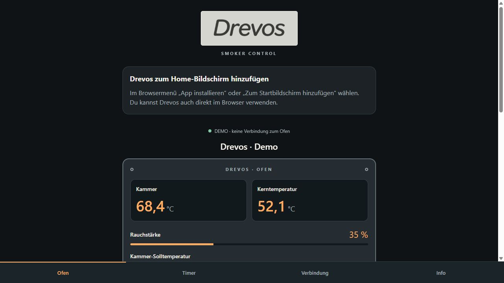

# Drevos-App – deutsche Anleitung

**Neu in 0.3.1:** Eigener vorläufiger Schriftzug und neue Bedingungen für Verkauf und kommerzielle Weitergabe. Nutzung bleibt kostenlos; frühere MIT-Rechte bleiben bestehen. [Lizenzdetails](docs/LICENSING.md).

**Lizenz ab 21.11.2026:** Private und betriebsinterne Nutzung kostenlos; Verkauf und kommerzielle Weitergabe nur mit vorheriger schriftlicher Freigabe von **Thomas Eigner**. [Bedingungen, frühere MIT-Fassungen und Kontakt](docs/LICENSING.md).

**Drevos läuft bereits in Home Assistant? [Nur die App ergänzen](docs/HA-UND-APP.de.md#a-home-assistant-funktioniert-schon-die-app-soll-dazukommen).** Umgekehrt: [Home Assistant zur bestehenden App hinzufügen](docs/HA-UND-APP.de.md#b-die-app-funktioniert-schon-home-assistant-soll-dazukommen).

**Neu hier? [Einfach starten – Pi und App installieren](docs/INSTALLATION.de.md).** Mit Materialliste, Befehlen zum Kopieren und Einrichtung von Web-App oder Handy-App.

**[Welcher Pi und welches Kabel?](docs/HARDWARE.md)** Für die normale Installation ist die Dienstadresse bereits hinterlegt; du musst keinen eigenen Dienstnamen einsetzen.

Die Drevos-App ist eine **eigenständige App für Android, iPhone/iPad und den Browser**. Sie benötigt weder Home Assistant noch ein VPN. Der Pi verbindet sich von innen mit dem gemeinsamen Vermittlungsdienst. Eine Portfreigabe am Router ist nicht erforderlich.

Die App und ihre Funktionen können für die Nutzer kostenlos angeboten werden. Den gemeinsamen Dienst richtet **einmalig der Betreiber des Projekts** ein. Die Nutzer brauchen kein Cloudflare-Konto, keinen eigenen Server und kein Abo. Kostenlose Hosting-Tarife haben Nutzungsgrenzen; ein beliebig großer, dauerhaft kostenloser Betrieb wird nicht zugesichert.

Version **0.3.1 ist eine Vorschau** mit Info-/Spenden-Tab, einstellbarer Android-Updateprüfung, Änderungsfenster und sichtbarer Versionsnummer. Der gemeinsame Dienst unter `https://drevos-relay.eigner-th2010.workers.dev` ist im Pi-Paket enthalten. Bei der früheren Version 0.2.0 wurden auf Android, iPhone und in der iPhone-Web-App echte Temperaturen, gespeicherte Kopplung und der Zugriff über mobile Daten bestätigt. Die Browserprüfungen und der Android-Build für 0.3.1 stehen getrennt in [VALIDATION](docs/VALIDATION.md). Es handelt sich um ein unabhängiges Community-Projekt; unterstützt wird das geprüfte SPS-Profil `drevos_fx3u_v1`.

## Web-App installieren

**[Drevos Web-App öffnen](https://drevos-smoker-control.thankfulchick1.chatgpt.site)**. Auf dem iPhone in Safari öffnen, **Teilen → Zum Home-Bildschirm** wählen und anschließend über das neue Symbol koppeln. Auf Android im Browser **App installieren** wählen. Kein Apple-Entwicklerabo und keine wöchentliche Signierung nötig. [Vollständige PWA-Anleitung](docs/WEB-APP.md).

## Native App herunterladen

Die [Android-APK 0.3.1 und der Quellcode](https://github.com/eignerth2010-byte/drevos-app/releases/tag/v0.3.1-preview.1) stehen zum Download bereit. `Drevos-Android-0.3.1-Vorschau.apk` über die vorhandene App installieren und das Update am Android-Gerät bestätigen. Vorher nicht deinstallieren. Der Android-Build verwendet weiterhin die bisherige Testsignatur. Das frühere [unsignierte iPhone-Paket 0.2.0](https://github.com/eignerth2010-byte/drevos-app/releases/tag/v0.2.0-preview.1) bleibt verfügbar und muss separat von Apple signiert werden; für diese Veröffentlichung wurde kein neues iPhone-Paket gebaut. [Update-Anleitung und Änderungsfenster](docs/UPDATES.md).

## Was benötigt wird

- Ein Drevos-Ofen mit dem **geprüften Steuerungsprofil `drevos_fx3u_v1`**. Der Markenname allein bestätigt keine Registerkompatibilität. Bei anderen Steuerungen dürfen Schreibbefehle erst nach Prüfung ihres Registerplans freigeschaltet werden.
- Raspberry Pi 3 B, 3 B+, 4 B oder Zero 2 W mit Raspberry Pi OS, Python 3.11+, Stromversorgung, microSD und Internetzugang. Alle verwenden dasselbe Programm. 64-Bit-OS wird empfohlen. Der Zero 2 W benötigt für das Programmierkabel zusätzlich einen USB-OTG-Adapter. Physisch geprüft ist bislang der 3 B+.
- Ein zur SPS elektrisch passendes USB-Programmierkabel. Der Name des USB-Chips allein bestätigt die Eignung nicht. Keine GPIO-Leitung direkt mit einer RS-232-Schnittstelle verbinden.
- Ein aktueller Browser mit HTTPS, IndexedDB und Web Crypto für die Web-App. Alternativ die native App: Android 7+ oder iOS/iPadOS 16.4+. Der Android-Testbuild enthält ARM64 und ARMv7.
- Der vom Betreiber bereitgestellte öffentliche Relay-Endpunkt. Die Nutzer erhalten ihn automatisch mit dem Pi-Paket und dem Kopplungscode.

## So läuft die Einrichtung für den Nutzer ab

1. Das geprüfte Pi-Programm installieren und den Pi mit Ofen und Heimnetz verbinden.
2. Die vorübergehende Pi-Einrichtungsseite öffnen, üblicherweise `http://drevos-pi.local:8765`.
3. In der App **Ofen koppeln** wählen und den QR-Code auf dieser Seite scannen.
4. Auf demselben Handy stattdessen **Code kopieren** auf der Pi-Seite und **Code einfügen** in der App verwenden.
5. **Ofen verbinden** drücken und die angezeigten Messwerte mit dem Display vergleichen. Danach die Einrichtungsseite mit **Fertig** schließen.

Der Code wird automatisch auf dem Pi erzeugt. Er enthält die private Kopplung dieses Ofens und darf nicht veröffentlicht werden. Die Seite ist nur im Heimnetz und nur für fünf Minuten geöffnet. Nach der einmaligen Einrichtung verwendet die App die gespeicherte Kopplung auch unterwegs. Der Pi und das Handy benötigen dazu Internetzugang; Home Assistant ist an diesem Weg nicht beteiligt.

## Pi-Installation aus dem Quellcode

Diese Schritte setzen das geprüfte SPS-Profil voraus. Für eine Erstinstallation Raspberry Pi OS aktualisieren und Python 3.11 oder neuer bereitstellen. Dieses Repository auf den Pi laden und dort öffnen.

```sh
sudo sh scripts/install-gateway.sh
```

Der Installer legt `/etc/drevos/gateway.json` privat an und startet die serielle Verbindung zunächst nicht. Ein einzelnes Gerät unter `/dev/serial/by-id/` wird als Adapter vorgeschlagen. Den tatsächlichen Adapter, das Profil und die Bind-Adresse lokal prüfen. Schreibbefehle sind bei einer neuen Konfiguration standardmäßig aus. Den Zugangsschlüssel nicht in den Chat oder in GitHub kopieren.

Andere Programme dürfen die serielle Schnittstelle nicht gleichzeitig verwenden. Danach:

```sh
sudo systemctl enable --now drevos-gateway.service drevos-native-poweroff.path
```

Temperaturen und Registerprofil am Display verifizieren. Nur beim bestätigten Profil `allow_control` in der privaten Konfiguration bewusst freigeben und den Gateway-Dienst neu starten. Die App funktioniert auch zum Ablesen, während die Bedienung gesperrt bleibt.

**Normale Installation:** Die gemeinsame Dienstadresse ist bereits in `cloud/endpoint.json` eingetragen. Führe auf dem Pi im Projektordner genau diesen Befehl aus; keine Adresse ergänzen und keinen Dienstnamen ersetzen:

```sh
sudo sh scripts/install-cloud.sh
```

Der verwendete gemeinsame Dienst lautet `https://drevos-relay.eigner-th2010.workers.dev`. Ein eigener Cloudflare-Zugang ist für Nutzer nicht erforderlich. Wer bewusst einen eigenen Dienst betreiben möchte, findet diesen getrennten Entwicklerweg in [cloud/README](cloud/README.md).

Der Installer installiert den getrennten Hintergrunddienst `drevos-cloud.service`. Seine privaten Schlüssel liegen unter `/etc/drevos-cloud/`. Ein älteres lokales Gateway wird auf die Version mit sofortiger Ablehnung beschäftigter Schreibzugriffe aktualisiert. Die vorhandene Gateway-Konfiguration und die SPS-Werte bleiben erhalten; beim Aktualisieren wird die API kurz neu gestartet.

Die Kopplungsseite anschließend für fünf Minuten öffnen. Mit dem in der einfachen Anleitung festgelegten Gerätenamen ist der Befehl direkt kopierbar:

```sh
sudo /opt/drevos-cloud/.venv/bin/drevos-cloud --pair --pair-bind drevos-pi.local
```

Im Heimnetz `http://drevos-pi.local:8765` öffnen und wie oben koppeln. Bei geändertem Hostnamen diesen im `--pair-bind`-Argument und in der Browseradresse einsetzen sowie mit `--pair-hostname` angeben. Keine Portfreigabe für diese Seite oder den Gateway-Port einrichten.

Prüfen:

```sh
systemctl is-active drevos-gateway.service drevos-cloud.service
```

Updates benutzen dieselben Installationsskripte. Bestehende Kopplungsschlüssel werden nicht neu erzeugt. Vor einer Schlüsselrotation die privaten Dateien sichern und bewusst neue Schlüssel/Kopplungen einrichten; eine gewöhnliche App-Abmeldung entfernt nur die Kopplung auf diesem Handy.

## Funktionen der App

**Ofen:** Kammer- und Kerntemperatur sowie Rauchstärke ablesen. Sollwerte eingeben und ausdrücklich **Übernehmen** drücken. Bereiche: Kammer 0–120 °C, Kernziel 0–115 °C, Rauch 0–100 %. Ein positiver Sollwert startet keine Funktion. Heizelement und Rauchbetrieb werden separat eingeschaltet und verlangen eine Bestätigung. Der Rauchbetrieb startet auch die automatische Zündung der SPS. Null deaktiviert die entsprechende Freigabe; Kernziel null deaktiviert das Kernkriterium.

**Timer:** Dauer 1–9999 Minuten einstellen, starten, pausieren und zurücksetzen. Lauf- und Restzeit kommen direkt von der SPS. Heizung und Rauch sind vom Timerstart getrennt. Pause/Reset und Pi-Abschaltung verlangen Heizung und Rauch aus; Reset und Abschaltung außerdem einen pausierten Timer.

**Verbindung:** Sprache ändern, Zustand aktualisieren, Kopplung auf diesem Handy entfernen oder Pi herunterfahren. Die App kann den ausgeschalteten Pi nicht wieder einschalten. Herunterfahren schaltet den Pi aus und ist kein Abschalten der Ofen-Stromversorgung.

Bei Verbindungsproblemen stehen Werte auf nicht verfügbar und die Bedienung wird gesperrt. Die App wiederholt keine unbestätigten Befehle. Nach einer Fehlermeldung den tatsächlichen Zustand prüfen. Das SPS-Programm läuft selbstständig weiter; die App ist kein Not-Aus. Automatikbetrieb und nicht unterstützte Temperatureinheiten sperren die manuelle Bedienung.

**Demo** verwendet ausschließlich Beispieldaten und verbindet sich mit keinem Ofen. Auch die Web-App unterstützt echte Kopplung und Fernzugriff. Sie speichert die Kopplung verschlüsselt im jeweiligen Browserprofil; native Apps verwenden den geschützten Betriebssystemspeicher. Die Details stehen in der [Web-App-Anleitung](docs/WEB-APP.md).

## Android und iPhone installieren

Die Build-Anleitung steht in [mobile/README](mobile/README.md). Ein Android-Vorschau-APK kann als Datei installiert werden. Für dauerhaft verteilte Updates einen eigenen gleichbleibenden Signierschlüssel verwenden.

Eine unsignierte iPhone-IPA lässt sich nicht direkt installieren. Für einen privaten Test ist eine persönliche Signierung erforderlich; ein möglicher Weg über Windows ist [Sideloadly](https://sideloadly.io/), dessen kostenlose Signierungen laut Anbieter nach sieben Tagen erneuert werden müssen. Apple-Zugangsdaten ausschließlich selbst im Anbieterfenster eingeben. Für eine bequeme öffentliche App-Store-Verteilung werden die erforderliche Entwicklerregistrierung, Signierung und Store-Prüfung separat eingerichtet. Die App kann für ihre Nutzer dabei kostenlos bleiben.

macOS 13 Ventura kann das für diesen Expo-SDK-58-Build benötigte Xcode 26.4+ nicht ausführen. Die GitHub-Builds verwenden einen gehosteten aktuellen Mac. Der Nutzer benötigt für die Bedienung der App keinen Mac.

## Betreiber des kostenlosen Vermittlungsdienstes

Nur der Projektbetreiber richtet den Dienst einmalig ein: [cloud/README](cloud/README.md). Das kostenlose Cloudflare-Kontingent wird nicht automatisch in ein kostenpflichtiges Abo umgewandelt; beim Erreichen der Gratisgrenzen kann die Verbindung ausfallen. Ein öffentlicher Dienst für viele Nutzer erfordert Kapazitätsplanung und Wartung. [Offizielle Tarifgrenzen](https://developers.cloudflare.com/durable-objects/platform/pricing/).

[Datenschutz und Schlüssel](docs/PRIVACY.md) · [Prüfstand](docs/VALIDATION.md) · [GitHub-Anleitung](docs/GITHUB.de.md) · [English](README.en.md)

## Vorschau



Drevos-App 0.3.1 – Web-App im Demomodus mit Beispielwerten.

## Mitwirkende

Erstellt von **Thomas Eigner**, mit KI-Unterstützung durch **ChatGPT (OpenAI)** bei Entwicklung, Tests und Dokumentation. [Alle Mitwirkenden](CONTRIBUTORS.md).

## Projekt unterstützen

Wenn dir dieses Projekt hilft, kannst du die Weiterentwicklung mit einer freiwilligen Spende über PayPal unterstützen. Vielen Dank!

[](https://www.paypal.com/donate/?hosted_button_id=GSMP9644VUY8C)

Alternativ kannst du den QR-Code scannen:

[](https://www.paypal.com/donate/?hosted_button_id=GSMP9644VUY8C)
