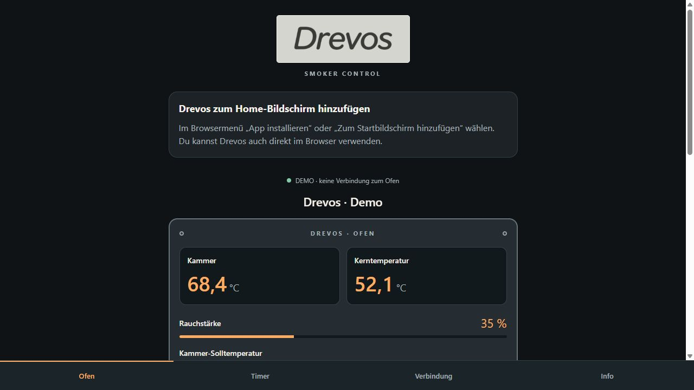

# Drevos app – English guide

**Already use Drevos in Home Assistant? [Add only the app](docs/HA-UND-APP.en.md#a-home-assistant-works-add-the-app).** Or [add HA to an existing app setup](docs/HA-UND-APP.en.md#b-the-app-works-add-home-assistant).

**New here? [Easy setup – install the Pi and app](docs/INSTALLATION.en.md).** Includes the hardware list, copyable commands and web/native app setup.

**[Pi models, supplies and exact cable](docs/HARDWARE.md)**. The shared service URL is preconfigured; normal users do not replace a relay/account placeholder.

This is a **standalone Android, iPhone/iPad and installable web app**. Home Assistant, VPN software and router port forwarding are not required. The Raspberry Pi makes an outbound connection to a shared relay service. An existing HA installation can continue independently.

App users can use the app and service free of charge. **The project operator** sets up the shared service once; ordinary users do not need a hosting account, server or subscription. Free hosting plans have capacity limits. Unlimited permanently free operation is not guaranteed.

Version **0.3.0 preview** adds a creator/support tab, configurable Android update checks, release notes and visible version numbers. The shared relay at `https://drevos-relay.eigner-th2010.workers.dev` is included in the Pi package. Earlier 0.2.0 Android/iPhone and iPhone Web App checks confirmed real temperatures, retained pairing and mobile-data access. The 0.3.0 browser checks and Android compilation are recorded separately in [validation](docs/VALIDATION.md). This is an independent community project; only the verified `drevos_fx3u_v1` PLC profile is supported.

## Install the Web App

**[Open Drevos Web App](https://drevos-smoker-control.thankfulchick1.chatgpt.site)**. On iPhone open in Safari, choose **Share → Add to Home Screen**, then pair inside the installed app. On Android choose **Install app** in the browser menu. No Apple Developer subscription or weekly signing is required. [Full PWA guide](docs/WEB-APP.md).

## Download the app

Download the [Android 0.3.0 preview APK and source](https://github.com/eignerth2010-byte/drevos-app/releases/tag/v0.3.0-preview.1). Install `Drevos-Android-0.3.0-Vorschau.apk` over the existing app and confirm the update on Android. Do not uninstall first. Android uses the existing template test signature. The earlier [unsigned iPhone 0.2.0 package](https://github.com/eignerth2010-byte/drevos-app/releases/tag/v0.2.0-preview.1) remains available and requires separate Apple signing; no new iPhone binary was built for this release. [Updates and release notes](docs/UPDATES.md).

## Requirements

- A smoker matching the verified **`drevos_fx3u_v1` PLC profile**. A Drevos badge alone does not establish compatibility. Other programs/controllers require register validation before enabling writes.
- Raspberry Pi 3 B, 3 B+, 4 B or Zero 2 W, Raspberry Pi OS, Python 3.11+, power supply, microSD and internet. All use the same program; 64-bit OS is recommended. Zero 2 W requires a USB OTG adapter for the cable. Only the 3 B+ has been physically verified.
- An electrically compatible PLC programming cable. A USB-chip name alone is insufficient; never connect GPIO directly to an RS-232 interface.
- A current browser with HTTPS, IndexedDB and Web Crypto for the web app. Alternatively, the native app: Android 7+ or iOS/iPadOS 16.4+. Android preview APKs include ARM64 and ARMv7.
- The operator-provided relay endpoint, automatically included in the Pi package and private pairing code.

## End-user setup

1. Install the verified Pi software and connect the Pi to the oven and home network.
2. Open the temporary Pi page, normally `http://drevos-pi.local:8765`.
3. In the app choose **Pair oven** and scan its QR code.
4. On the same phone, use **Copy code** on the Pi page, then **Paste code** in the app.
5. Press **Connect oven**, compare readings with the oven display, then close the setup page with **Done**.

The Pi generates the private code automatically. Keep it private: it grants access to this oven. The page is only opened on the home LAN for five minutes. Pair once at home; the saved pairing then works when away. Both Pi and phone need internet, with no HA involvement.

## Pi installation from source

Install Raspberry Pi OS with Python 3.11+ and copy this repository to the Pi. Run:

```sh
sudo sh scripts/install-gateway.sh
```

The installer creates private `/etc/drevos/gateway.json` without starting serial access. It proposes an adapter only when exactly one `/dev/serial/by-id/` device exists. Review the actual adapter, verified profile and bind address locally. New installations default to read-only control. Never publish its token.

Stop any competing serial-port service, then:

```sh
sudo systemctl enable --now drevos-gateway.service drevos-native-poweroff.path
```

Verify readings and the controller profile against the display. Enable `allow_control` deliberately only for the verified profile, then restart the gateway. The app can display readings while controls remain disabled.

**Normal installation:** The shared service is already configured in `cloud/endpoint.json`. Run exactly this command in the Pi project folder; do not append a server URL or replace an account placeholder:

```sh
sudo sh scripts/install-cloud.sh
```

The included shared service is `https://drevos-relay.eigner-th2010.workers.dev`. App users do not need a Cloudflare account. Running your own relay is a separate developer route in [cloud/README](cloud/README.md).

The installer adds the separate `drevos-cloud.service`, with private keys under `/etc/drevos-cloud/`. It upgrades older gateway software to the version that immediately refuses busy writes, preserving existing configuration and PLC values. A gateway upgrade briefly restarts its API.

Open the five-minute LAN pairing page using the hostname from the easy setup guide:

```sh
sudo /opt/drevos-cloud/.venv/bin/drevos-cloud --pair --pair-bind drevos-pi.local
```

Visit `http://drevos-pi.local:8765` on the home network. If the hostname differs, use it in `--pair-bind` and the browser URL and also specify it with `--pair-hostname`. Never forward this setup page or the local gateway port to the internet.

Check startup:

```sh
systemctl is-active drevos-gateway.service drevos-cloud.service
```

Updates reuse the same scripts and preserve existing pairing keys. Back up private configuration before deliberately rotating keys. Removing pairing in the app only forgets this phone; it does not revoke other paired phones.

## Controls

**Oven:** view chamber/core temperatures and smoke level. Edit targets and press **Apply**. Limits: chamber 0–120 °C, core 0–115 °C, smoke 0–100%. A positive target does not start heating or smoke. Separate heating/smoke starts ask for confirmation; smoke also triggers the PLC's automatic ignition. Zero disables the relevant request; a zero core target disables that completion criterion.

**Timer:** set 1–9999 minutes, start, pause and reset. Elapsed/remaining time comes from the PLC, not a phone clock. Starting the timer does not start heating or smoke. Pause/reset/shutdown require heating and smoke off; reset/shutdown also require a paused timer.

**Connection:** change language, refresh, remove this phone's pairing or shut down the Pi. The app cannot power the Pi back on. Pi shutdown does not disconnect oven mains power.

Loss of connectivity makes readings unavailable and disables controls. Unconfirmed writes are never retried automatically; inspect actual oven state after an error. The PLC continues independently. This app is not an emergency stop. Automatic mode and unsupported temperature units lock manual controls.

The **demo** is isolated synthetic data. The web app also supports real pairing and remote access. It encrypts pairing in origin-local browser storage; native apps use the operating system's protected storage. See the [PWA guide](docs/WEB-APP.md).

## Installing Android/iPhone builds

See [mobile/README](mobile/README.md). Android preview APKs can be installed as files. Use a persistent private signing key for maintained public updates.

An unsigned iPhone IPA cannot be installed directly. Private testing needs personal Apple signing; [Sideloadly](https://sideloadly.io/) is one possible Windows route, with free signing renewed every seven days according to its provider. Enter Apple credentials yourself only in the relevant sign-in window. Convenient App Store distribution needs separate developer registration, signing and review. The app can still be free for end users.

macOS 13 Ventura cannot run the Xcode 26.4+ required for this Expo SDK 58 project. GitHub builds use a hosted current Mac; app users do not need a Mac.

## Service operator

Only the project operator provisions the relay once: [cloud/README](cloud/README.md). Cloudflare's free plan has hard usage limits and does not automatically become a paid subscription; exceeding limits can interrupt connectivity. Plan capacity and maintenance before serving many users. [Official limits](https://developers.cloudflare.com/durable-objects/platform/pricing/).

[Privacy](docs/PRIVACY.md) · [Validation](docs/VALIDATION.md) · [GitHub guide](docs/GITHUB.en.md) · [Deutsch](README.de.md)

## Preview



Drevos app 0.3.0 – Web App in demo mode with sample values.

## Contributors

Created by **Thomas Eigner**, with AI assistance from **ChatGPT (OpenAI)** for development, software checks and documentation. [Contributor acknowledgements](CONTRIBUTORS.md).

## Support this project

If this project helps you, you can support its continued development with a voluntary donation via PayPal. Thank you!

[](https://www.paypal.com/donate/?hosted_button_id=GSMP9644VUY8C)

Or scan the QR code:

[](https://www.paypal.com/donate/?hosted_button_id=GSMP9644VUY8C)
