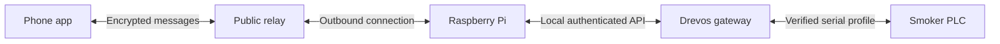
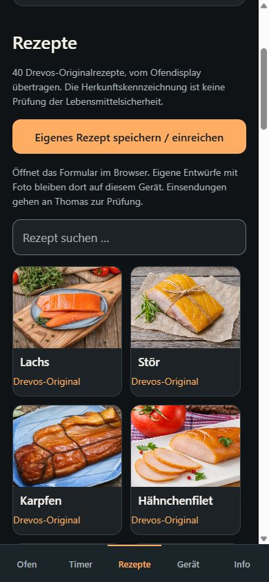
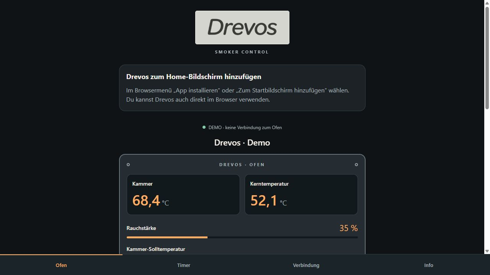

# Drevos App

**[Rezepte ohne weitere App-Updates / Shared recipe catalog](docs/ONLINE-RECIPES.de.md)** · **[English](docs/ONLINE-RECIPES.en.md)**

**Neu: [40 Rezepte und eigene Rezeptvorschläge – Deutsch](docs/RECIPES.de.md)** · **[Recipes and personal drafts – English](docs/RECIPES.en.md)**

  
  

  
  
  
  
  

**Lizenz ab 21.11.2026:** Private und betriebsinterne Nutzung kostenlos; Verkauf und kommerzielle Weitergabe nur mit vorheriger schriftlicher Freigabe von **Thomas Eigner**. [Bedingungen, frühere MIT-Fassungen und Kontakt](docs/LICENSING.md).

**License from 2026-11-21:** Free for private and internal business use; resale and commercial redistribution require **Thomas Eigner's prior written permission**. [Terms, earlier MIT versions and contact](docs/LICENSING.md).

**Already have HA or the app? [Was brauche ich zusätzlich?](docs/HA-UND-APP.de.md)** · **[HA + app, English](docs/HA-UND-APP.en.md)**

**[Einfach starten – Pi und App installieren](docs/INSTALLATION.de.md)** · **[Easy setup – Pi and app](docs/INSTALLATION.en.md)**

[Welcher Pi, welches Netzteil und welches Kabel? / Hardware list](docs/HARDWARE.md)

[Deutsch – vollständige Anleitung](README.de.md) · [English – complete guide](README.en.md)

Standalone **iOS, Android and installable web app** for a Drevos smoker connected to a Raspberry Pi. Home Assistant, a VPN and router port forwarding are not required. An optional existing Home Assistant integration can continue using the same local gateway.

The owner pairs their oven by scanning or pasting a private code from the Pi's temporary setup page. The same pairing works at home and away through an encrypted, live-only relay. Ordinary app users do not need a hosting account, their own server or a subscription. The service operator needs one hosting account; free-tier usage is limited.

Version **0.5.0 preview** adds a shared online recipe catalog. After this one-time update, new recipe entries load without another app release; the last good text/settings are saved locally. Selected phases retain their values and all controls remain manual. The existing configured Pi needs no update. [Online recipe guide](docs/ONLINE-RECIPES.en.md). Local checks passed; native compilation and physical-device validation are recorded separately in [validation](docs/VALIDATION.md). Only the verified `drevos_fx3u_v1` PLC profile is supported.

Download the [Android 0.5.0 preview APK, source and unsigned iPhone package](https://github.com/eignerth2010-byte/drevos-app/releases/tag/v0.5.0-preview.1). Install `Drevos-Android-0.5.0-preview.apk` over the existing app and confirm the update on Android. Do not uninstall first. Android uses the existing template test signature (versionCode 6). The new unsigned iPhone 0.5.0 package requires separate Apple signing. [Updates and release notes](docs/UPDATES.md).

**[Open the installable Web App](https://drevos-smoker-control.thankfulchick1.chatgpt.site)** · [iPhone/Android installation and self-hosting guide](docs/WEB-APP.md). Open in Safari on iPhone, add to the Home Screen, then pair inside the installed app. No weekly Apple signing is required for the web app.

Included: native app, installable PWA and smoker-style interface, local Pi gateway, outbound encrypted Pi agent, Cloudflare relay source, short-lived QR/copy pairing page, installers, systemd units, tests, and German/English user and GitHub guides.

The temporary community wordmark and resale terms introduced in 0.3.1 remain unchanged. Private and internal business use remain free; earlier MIT versions retain their rights. [License details](docs/LICENSING.md).

## Connection

The relay cannot decrypt readings or control messages. Commands require a fresh one-use ticket from the Pi, are checked again by the local gateway, and are never retained for later delivery. Loss of connectivity disables the app's controls; the PLC continues its own program.

## Source and license

- [Web app / PWA](docs/WEB-APP.md)
- [Mobile app](mobile/README.md)
- [Relay deployment](cloud/README.md)
- [Protocol](docs/PROTOCOL.md) and [privacy](docs/PRIVACY.md)
- [GitHub publishing: DE](docs/GITHUB.de.md) / [EN](docs/GITHUB.en.md)
- [Free-use license](LICENSE); project artwork and brand names have [separate notes](mobile/BRAND-NOTICE.md).

Keep gateway configuration, cloud agent configuration and pairing codes private. Neither real credentials nor the original PLC project are part of this repository.

## Vorschau / Preview

40 Rezepte mit aufbereiteten Bildern, Quellenhinweisen und einzeln vorbereiteten Phasen. Gezeigt ist die Web-App im Demomodus. / 40 recipes with restored photos, source notes and separate phase preparation; Web App in demo mode.

Drevos-App 0.3.1 – Web-App im Demomodus mit Beispielwerten. / Drevos app 0.3.1 – Web App in demo mode with sample values.

## Mitwirkende / Contributors

**Thomas Eigner** – Ersteller / creator. **ChatGPT (OpenAI)** – KI-Unterstützung bei Entwicklung, Tests und Dokumentation / AI assistance with development, software checks and documentation. [Details](CONTRIBUTORS.md).

## Unterstützen / Support

Wenn dir dieses Projekt hilft, kannst du die Weiterentwicklung mit einer freiwilligen Spende über PayPal unterstützen. Vielen Dank!

If this project helps you, you can support its continued development with a voluntary donation via PayPal. Thank you!

QR-Code scannen / Scan the QR code:

