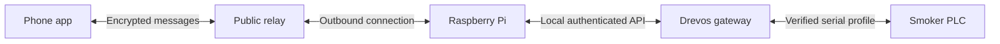

# Drevos App

**Lizenz ab 21.11.2026:** Private und betriebsinterne Nutzung kostenlos; Verkauf und kommerzielle Weitergabe nur mit vorheriger schriftlicher Freigabe von **Thomas Eigner**. [Bedingungen, frühere MIT-Fassungen und Kontakt](docs/LICENSING.md).

**License from 2026-11-21:** Free for private and internal business use; resale and commercial redistribution require **Thomas Eigner's prior written permission**. [Terms, earlier MIT versions and contact](docs/LICENSING.md).

**Already have HA or the app? [Was brauche ich zusätzlich?](docs/HA-UND-APP.de.md)** · **[HA + app, English](docs/HA-UND-APP.en.md)**

**[Einfach starten – Pi und App installieren](docs/INSTALLATION.de.md)** · **[Easy setup – Pi and app](docs/INSTALLATION.en.md)**

[Welcher Pi, welches Netzteil und welches Kabel? / Hardware list](docs/HARDWARE.md)

[Deutsch – vollständige Anleitung](README.de.md) · [English – complete guide](README.en.md)

Standalone **iOS, Android and installable web app** for a Drevos smoker connected to a Raspberry Pi. Home Assistant, a VPN and router port forwarding are not required. An optional existing Home Assistant integration can continue using the same local gateway.

The owner pairs their oven by scanning or pasting a private code from the Pi's temporary setup page. The same pairing works at home and away through an encrypted, live-only relay. Ordinary app users do not need a hosting account, their own server or a subscription. The service operator needs one hosting account; free-tier usage is limited.

Version **0.3.1 preview** adds a creator/support tab, configurable Android update checks, release notes and visible version numbers. The shared relay at `https://drevos-relay.eigner-th2010.workers.dev` is included in the Pi package. Earlier 0.2.0 Android/iPhone and iPhone Web App checks confirmed real temperatures, retained pairing and mobile-data access. The 0.3.1 browser checks and Android compilation are recorded separately in [validation](docs/VALIDATION.md). This is an independent community project; only the verified `drevos_fx3u_v1` PLC profile is supported.

Download the [Android 0.3.1 preview APK and source](https://github.com/eignerth2010-byte/drevos-app/releases/tag/v0.3.1-preview.1). Install `Drevos-Android-0.3.1-Vorschau.apk` over the existing app and confirm the update on Android. Do not uninstall first. Android uses the existing template test signature. The earlier [unsigned iPhone 0.2.0 package](https://github.com/eignerth2010-byte/drevos-app/releases/tag/v0.2.0-preview.1) remains available and requires separate Apple signing; no new iPhone binary was built for this release. [Updates and release notes](docs/UPDATES.md).

**[Open the installable Web App](https://drevos-smoker-control.thankfulchick1.chatgpt.site)** · [iPhone/Android installation and self-hosting guide](docs/WEB-APP.md). Open in Safari on iPhone, add to the Home Screen, then pair inside the installed app. No weekly Apple signing is required for the web app.

Included: native app, installable PWA and smoker-style interface, local Pi gateway, outbound encrypted Pi agent, Cloudflare relay source, short-lived QR/copy pairing page, installers, systemd units, tests, and German/English user and GitHub guides.

Version **0.3.1** also uses a temporary community wordmark and revised resale terms. Private and internal business use remain free; earlier MIT versions retain their rights. [License details](docs/LICENSING.md).

## Connection

The relay cannot decrypt readings or control messages. Commands require a fresh one-use ticket from the Pi, are checked again by the local gateway, and are never retained for later delivery. Loss of connectivity disables the app's controls; the PLC continues its own program.

## Source and license

- [Web app / PWA](docs/WEB-APP.md)
- [Mobile app](mobile/README.md)
- [Relay deployment](cloud/README.md)
- [Protocol](docs/PROTOCOL.md) and [privacy](docs/PRIVACY.md)
- [GitHub publishing: DE](docs/GITHUB.de.md) / [EN](docs/GITHUB.en.md)
- [Free-use license](LICENSE); project artwork and brand names have [separate notes](mobile/BRAND-NOTICE.md).

Keep gateway configuration, cloud agent configuration and pairing codes private. Neither real credentials nor the original PLC project are part of this repository.

## Vorschau / Preview

Drevos-App 0.3.1 – Web-App im Demomodus mit Beispielwerten. / Drevos app 0.3.1 – Web App in demo mode with sample values.

## Mitwirkende / Contributors

**Thomas Eigner** – Ersteller / creator. **ChatGPT (OpenAI)** – KI-Unterstützung bei Entwicklung, Tests und Dokumentation / AI assistance with development, software checks and documentation. [Details](CONTRIBUTORS.md).

## Unterstützen / Support

Wenn dir dieses Projekt hilft, kannst du die Weiterentwicklung mit einer freiwilligen Spende über PayPal unterstützen. Vielen Dank!

If this project helps you, you can support its continued development with a voluntary donation via PayPal. Thank you!

QR-Code scannen / Scan the QR code:

