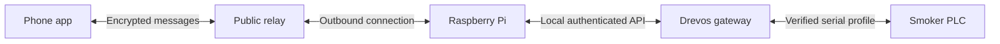

# Drevos App

[Deutsch – vollständige Anleitung](README.de.md) · [English – complete guide](README.en.md)

Standalone **iOS, Android and installable web app** for a Drevos smoker connected to a Raspberry Pi. Home Assistant, MQTT, a VPN and router port forwarding are not required. An optional existing Home Assistant integration can continue using the same local gateway.

The owner pairs their oven by scanning or pasting a private code from the Pi's temporary setup page. The same pairing works at home and away through an encrypted, live-only relay. Ordinary app users do not need a hosting account, their own server or a subscription. The service operator needs one hosting account; free-tier usage is limited.

Version **0.2.0 preview**. The shared relay is running at `https://drevos-relay.eigner-th2010.workers.dev` and is included in the Pi package. Encrypted reads from a real Pi/oven and disconnection/reconnection have passed. The user confirmed QR pairing, real temperature readings and access outside the home Wi-Fi on a physical Android device. Native Android/iPhone builds passed. The user also confirmed iPhone pairing, retained pairing after restart and live readings over mobile data. The web app passed desktop-browser pairing, live reading, reload and logout checks; the user confirmed iPhone Home Screen installation, camera QR pairing, retained pairing after a full restart and live readings over mobile data. See [validation](docs/VALIDATION.md). This is a community project, not an official Drevos product. Only the verified `drevos_fx3u_v1` PLC register profile is supported.

Download the [Android preview APK, unsigned iPhone IPA and source package](https://github.com/eignerth2010-byte/drevos-app/releases/tag/v0.2.0-preview.1). Android uses a test signature; iPhone installation requires separate signing. This is a preview for device testing, not a production release.

**[Open the installable Web App](https://drevos-smoker-control.thankfulchick1.chatgpt.site)** · [iPhone/Android installation and self-hosting guide](docs/WEB-APP.md). Open in Safari on iPhone, add to the Home Screen, then pair inside the installed app. No weekly Apple signing is required for the web app.

Included: native app, installable PWA and smoker-style interface, local Pi gateway, outbound encrypted Pi agent, Cloudflare relay source, short-lived QR/copy pairing page, installers, systemd units, tests, and German/English user and GitHub guides.

## Connection

The relay cannot decrypt readings or control messages. Commands require a fresh one-use ticket from the Pi, are checked again by the local gateway, and are never retained for later delivery. Loss of connectivity disables the app's controls; the PLC continues its own program.

## Source and license

- [Web app / PWA](docs/WEB-APP.md)
- [Mobile app](mobile/README.md)
- [Relay deployment](cloud/README.md)
- [Protocol](docs/PROTOCOL.md) and [privacy](docs/PRIVACY.md)
- [GitHub publishing: DE](docs/GITHUB.de.md) / [EN](docs/GITHUB.en.md)
- [MIT license](LICENSE); supplied brand assets have [separate terms](mobile/BRAND-NOTICE.md).

Keep gateway configuration, cloud agent configuration and pairing codes private. Neither real credentials nor the original PLC project are part of this repository.

## Unterstützen / Support

Wenn dir dieses Projekt hilft, kannst du die Weiterentwicklung mit einer freiwilligen Spende über PayPal unterstützen. Vielen Dank!

If this project helps you, you can support its continued development with a voluntary donation via PayPal. Thank you!

QR-Code scannen / Scan the QR code:

